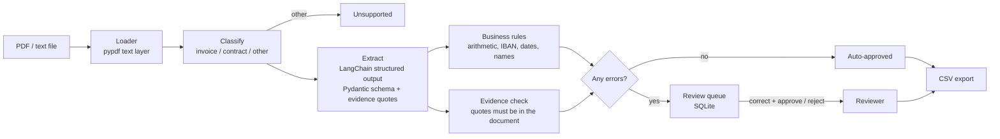

# Invoice & Contract Extraction with LangChain

[](https://github.com/nitanandsinghupw/langchain-document-extraction/actions/workflows/ci.yml)


A reference implementation of LLM document extraction you can actually let run unattended: invoices and
contracts become **typed, validated JSON**, every key value must be **backed by a quote from the
document**, **business rules** catch what the model gets wrong, and anything doubtful goes to a **human
review queue** instead of into your accounting system.

```
$ doc-extract run data/samples/*.txt
ctr-001.txt      contract  auto_approved
ctr-002.txt      contract  needs_review
                 - The end date 2025-05-31 is not after the effective date 2025-06-01.
inv-001.txt      invoice   auto_approved
inv-003.txt      invoice   needs_review
                 - Subtotal 13900.00 + tax 2919.00 = 16819.00, but the total is 16919.00.
inv-004.txt      invoice   needs_review
                 - IBAN DE89370400440532013001 fails the checksum.
inv-005.txt      invoice   needs_review
                 - The invoice has no due date.
memo-001.txt     other     unsupported
                 - Not an invoice or a contract.
```

All sample documents are fictional. The full JSON for one invoice is in
[`examples/inv-001.json`](examples/inv-001.json).

## How it works



## Design decisions

**1. Typed schemas, money as `Decimal`.**
[`schemas.py`](src/doc_extraction/schemas.py) defines `Invoice` and `Contract` with real types: dates are
dates, amounts are `Decimal` (never float, so 0.1 + 0.2 is still 0.3), and currency is an ISO code. The
model's output is validated against these, and an invalid reply is sent back once with the errors.

**2. Evidence for every key field.**
The model must quote the text each key value came from, and [`grounding.py`](src/doc_extraction/grounding.py)
checks that each quote really appears in the document (ignoring spacing and case). A value the model
can't point to goes to review. This is the cheapest defence against hallucinated values.

**3. Deterministic rules catch model mistakes.**
[`validation.py`](src/doc_extraction/validation.py) checks what code does better than any model: line
items × prices, subtotal + tax = total (to the cent), the IBAN mod-97 checksum, due date after issue date,
contract end after start, plausible notice periods, and whether a "name" is really a sentence fragment.

**4. Fail safe, not silent.**
Anything that fails a rule, lacks evidence or can't be extracted goes to the review queue with the reasons.
The system is judged on **unsafe auto-approvals** (approved without review but with a wrong field), not
just accuracy.

**5. Humans close the loop.**
A reviewer can correct fields and approve, or reject. Corrections are re-validated before they're accepted.
Every decision records who made it and when, and approved invoices export to CSV for accounting.

**6. Duplicate protection.**
An invoice with the same vendor and invoice number as an earlier one is held for review, so uploading the
same invoice twice (as a PDF and as an email attachment, say) doesn't lead to paying it twice.

## Evaluation

`doc-extract eval` runs the pipeline over 12 labelled documents and compares every field with the labels
in [`data/labels.json`](data/labels.json). Ten documents are **tuned** (the offline rules were written
against them) and two are **held out**: an invoice and a contract in layouts and wording the rules never
saw.

Results with the offline, rule-based model:

| Split | Docs | Classified | Routed as expected | Fields correct | Unsafe auto-approvals |
|---|---:|---:|---:|---:|---:|
| Tuned | 10 | 100% | 100% | 100% | 0 |
| Held out | 2 | 100% | 0% | 10% | **0** |

What these numbers say:

- **Rules don't generalise.** On unseen layouts ("Issued: September 3, 2025", "commences on 1 April 2025",
  "two weeks' notice") the rules extract almost nothing. That gap is exactly what an LLM closes, and the
  evaluation is how you'd prove it: run `doc-extract --provider openai eval`.
- **But they fail safe.** Both held-out documents went to review instead of being approved with bad data.
- **Evidence is necessary, not sufficient.** The first evaluation run found one unsafe auto-approval: the
  rules extracted a contract party as *"This Supply Agreement is entered into by Voltwerk Components BV"*.
  That text really is in the document, so the evidence check passed. The fix was a general name
  plausibility rule, which now catches this kind of error from any model. Finding problems like this is
  the point of having an evaluation.

## Run it

```bash
pip install -e ".[dev]"
doc-extract run data/samples/*.txt data/pdf/inv-001.pdf
doc-extract eval
pytest -q
```

With a real model (see [`.env.example`](.env.example)):

```bash
pip install -e ".[openai]"
export EXTRACTION_MODEL_PROVIDER=openai OPENAI_API_KEY=sk-...
doc-extract eval
```

Structured output uses function calling rather than OpenAI's strict JSON-schema mode, because strict mode
rejects the regex pattern Pydantic generates for `Decimal` fields. Pydantic validates every result either
way.

## API

```bash
uvicorn doc_extraction.api:app --reload
```

| Method | Route | Purpose |
|---|---|---|
| POST | `/extract` | Upload a PDF, `.txt` or `.md` file |
| POST | `/extract/text` | Extract from text in the request body |
| GET | `/documents?status=needs_review` | The review queue (or any status) |
| GET | `/documents/{id}` | One result |
| POST | `/documents/{id}/review` | `approve` (with optional `corrections`) or `reject` |
| GET | `/export/invoices.csv` | Approved invoices for accounting import |

```bash
curl -F "file=@data/samples/inv-003.txt" localhost:8000/extract
curl -X POST localhost:8000/documents/<id>/review -H "Content-Type: application/json" \
  -d '{"action":"approve","reviewer":"maria","corrections":{"total":"16819.00"},"note":"Confirmed with vendor"}'
```

## Project layout

```
src/doc_extraction/
  schemas.py        Invoice and Contract models, evidence requirements
  pipeline.py       classify -> extract -> validate -> route
  structured.py     Structured output with a repair attempt
  validation.py     Business rules (arithmetic, IBAN, dates, names)
  grounding.py      Evidence quote check
  review_store.py   SQLite store, review decisions, duplicate lookup
  evaluate.py       Field-level evaluation against labels
  offline_model.py  Rule-based stand-in model and baseline
  loaders.py        Text and PDF loading
  api.py            FastAPI service
data/samples/       12 fictional invoices, contracts and a memo; data/pdf/ has a PDF version
tests/              30 pytest tests
```

## Production checklist

This is a reference implementation. Before running it for real:

- Add OCR (Azure AI Document Intelligence or Tesseract) for scanned PDFs without a text layer.
- Replace SQLite with Postgres, and add authentication and roles for reviewers.
- Grow the labelled set from real documents, and run the evaluation in CI before changing prompts or models.
- Track review corrections per field: they show where the prompt or rules need work.
- Match invoices against purchase orders, and check vendor IBANs against a known list to stop payment fraud.

## License

[MIT](LICENSE)
